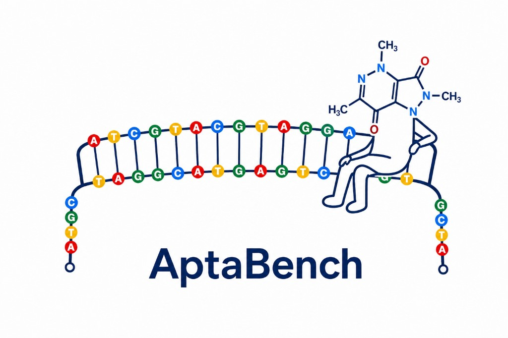

<p align="center">
  
</p>

# AptaBench: A Benchmark for Aptamer–Small Molecule Binding

[](https://neurips.cc/virtual/2026/poster/139036)
[](https://huggingface.co/datasets/GenerativeMolMachines/AptaBench_dataset)
[](LICENSE)

**Mariia Eremeyeva, Nikita Serov**  
NeurIPS 2026 Evaluations and Datasets Track (poster)

AptaBench is a curated benchmark for predicting whether a DNA/RNA aptamer binds a small molecule — and, when affinity is available, how strongly. It is meant for **model developers**: load the fixed table and splits, train your model, and report scores under leakage-aware protocols that separate interpolation from transfer to new ligands or sequence families.

| | |
|---|---|
| Pairs | 6,289 aptamer–ligand records |
| Aptamers / ligands | 1,610 sequences · 942 molecules |
| Tasks | Binding classification · pKd regression |
| Negatives | Experimentally reported (not random cross-pairs) |
| Evaluation | Fixed 5-fold stratified, molecule-disjoint, aptamer-disjoint splits |

**Paper:** [NeurIPS 2026 poster](https://neurips.cc/virtual/2026/poster/139036) · **Dataset:** [Hugging Face](https://huggingface.co/datasets/GenerativeMolMachines/AptaBench_dataset)

## Why use it

Random train/test splits overestimate performance when the same ligand scaffolds or similar aptamer sequences appear on both sides. AptaBench ships three complementary protocols so you can measure:

1. **In-distribution** performance on held-out pairs from the observed sequence–ligand space  
2. **Molecule-disjoint** transfer to unseen ligand scaffolds  
3. **Aptamer-disjoint** transfer to held-out aptamer sequence clusters  

Inactive labels come from reported non-binding or low-affinity measurements, not synthetic negatives.

## Install

Minimal (load data + run your own code):

```bash
pip install pandas datasets
```

Full repo (baselines, notebooks, encoders):

```bash
git clone https://github.com/GenerativeMolMachines/AptaBench.git
cd AptaBench
conda env create -f environment.yml
conda activate aptabench
pip install -e .
```

Optional heavy encoders: `pip install -e ".[full]"`.

## Load the data

**Hugging Face**

```python
from datasets import load_dataset

ds = load_dataset("GenerativeMolMachines/AptaBench_dataset", split="train")
# columns: type, sequence, canonical_smiles, pKd_value, label, buffer, origin, source
```

**Local CSV + fixed folds** (same content as the HF release)

```python
import json
import pandas as pd

data = pd.read_csv("dataset/AptaBench_dataset.csv")

with open("dataset/splits/stratified.json") as f:          # in-distribution
    splits = json.load(f)
# also: disjoint_molecule.json, disjoint_aptamer.json

fold = splits[0]
train = data.iloc[fold["train_idx"]]
test = data.iloc[fold["val_idx"]]  # held-out fold used as validation/test
```

Each split JSON is a list of five folds with zero-based `train_idx` / `val_idx` into the table.

### Fields

| Column | Meaning |
|--------|---------|
| `type` | `DNA` or `RNA` |
| `sequence` | Standardized aptamer sequence |
| `canonical_smiles` | Canonical ligand SMILES |
| `label` | `1` active, `0` inactive / low-affinity |
| `pKd_value` | Affinity when available (else missing) |
| `source` | Curated source name |
| `origin` / `buffer` | Provenance and assay context when reported |

## Evaluate your model

Use the **released fold indices** — do not reshuffle. Report all three protocols.

```python
from sklearn.metrics import roc_auc_score, average_precision_score

def eval_classification(model, data, split_path):
    import json
    with open(split_path) as f:
        folds = json.load(f)
    scores = []
    for fold in folds:
        train = data.iloc[fold["train_idx"]]
        test = data.iloc[fold["val_idx"]]
        model.fit(train)  # your training API
        prob = model.predict_proba(test)
        scores.append({
            "roc_auc": roc_auc_score(test["label"], prob),
            "pr_auc": average_precision_score(test["label"], prob),
        })
    return scores
```

**Classification** (all rows): ROC-AUC, PR-AUC, balanced accuracy, F1, precision, recall.  
**Regression** (rows with `pKd_value`): R², RMSE, MAE, Spearman ρ.

Report **mean ± std over the five folds**. Prefer molecule- and aptamer-disjoint numbers when claiming generalization to new chemistry or new sequence families.

### Suggested reporting template

| Protocol | ROC-AUC / R² | Other metrics… |
|----------|--------------|----------------|
| Stratified (in-distribution) | | |
| Molecule-disjoint | | |
| Aptamer-disjoint | | |

Paper LightGBM baselines (best per protocol): classification ROC-AUC **0.95 / 0.89 / 0.87**; regression R² **0.67 / 0.30 / 0.32**.

## What this repo contains

| Path | Role |
|------|------|
| `dataset/` | Released table, split JSONs, Croissant metadata |
| `notebooks/` | Construction, exploration, ML/DL baselines |
| `src/` | Data utilities, encoders, screening helpers |
| `artifacts/` | Published baseline result tables |
| `REPRODUCE.md` | Map from paper tables to notebooks |
| `REBUTTAL_RESULTS.md` | Short summary of follow-up analyses |

Notebooks: `01` build the dataset · `02` explore · `03` classical ML · `04` deep models.

## Citation

```bibtex
@inproceedings{eremeyeva2026aptabench,
  title     = {AptaBench: A Benchmark for Aptamer-Small Molecule Binding},
  author    = {Eremeyeva, Mariia and Serov, Nikita},
  booktitle = {NeurIPS 2026 Evaluations and Datasets Track},
  year      = {2026}
}
```

## License

Code: [MIT](LICENSE). Dataset: **CC BY 4.0** (see the [dataset card](https://huggingface.co/datasets/GenerativeMolMachines/AptaBench_dataset)).
